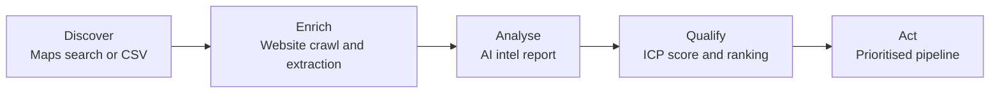

<div align="center">

# RECON

### Lead intelligence, automated.

**Find prospects on Google Maps. Enrich them with website data. Score them against your ideal customer profile with AI-generated reports.**

[](LICENSE.md)
[](COMMERCIAL-LICENSE.md)


[Features](#features) · [How it works](#how-it-works) · [Getting started](#getting-started) · [Documentation](#documentation) · [License](#license)

</div>

---

## The problem

Outbound sales teams lose hours to research before a single conversation happens. Reps visit websites, hunt for decision-makers, read reviews and check competitors, then repeat the process for every lead. It's slow, it doesn't scale, and every rep qualifies leads differently.

## The solution

**Recon does that research for you.** Give it a territory and a keyword, or upload a list, and it returns a scored, prioritised pipeline with a full intelligence report on every business.

| | Manual research | With Recon |
|---|---|---|
| **Time per lead** | 25–40 minutes | A few minutes, automated |
| **Consistency** | Varies by rep | Every lead scored against the same ICP |
| **Scale** | Tens of leads a week | Hundreds of leads per run |
| **Output** | Scattered notes | Structured reports, ready to act on |

---

## Features

### Google Maps prospecting
Search any keyword in any location. Recon splits the area into a grid so nothing is missed, then collects each business's name, address, phone, rating, review count and website.

### Website enrichment
Crawls every prospect's website and extracts company details, contact information, social profiles, services and buying signals.

### AI intel reports
Turns raw research into a clear, structured report covering a company overview, key contacts, review sentiment and competitor analysis. It's powered by Anthropic Claude and Google Gemini.

### ICP-based qualification
Define your Ideal Customer Profile once. Every lead is scored against the same criteria, so you can sort a list of hundreds in minutes and focus on the best fits first.

### Bulk import
Already have a list? Upload a CSV or Excel file and qualify the whole list at once.

### History and export
Every search and report is saved. Reopen past results at any time and export them to your existing tools.

---

## How it works



1. **Discover:** pull every matching business in a territory from Google Maps, or import your own list.
2. **Enrich:** crawl each website to collect contacts, services and signals.
3. **Analyse:** AI builds a structured intelligence report for each business.
4. **Qualify:** each lead is scored against your ICP and ranked by fit.
5. **Act:** work the list from the top, with all the context already in front of you.

---

## Tech stack

| Layer | Technology |
|---|---|
| **Frontend** | React · Vite · TypeScript |
| **Backend** | Node.js · Express 5 · TypeScript |
| **Crawling** | Crawlee · Playwright (Google Maps) · Cheerio (websites) |
| **AI** | Anthropic Claude · Google Gemini |
| **Data** | PostgreSQL · Drizzle ORM |
| **Tooling** | pnpm workspaces · esbuild · OpenAPI code generation |

### Project structure

```
recon/
├── artifacts/
│   ├── api-server/   # Backend: crawling, Maps search, AI reports, qualification
│   └── dashboard/    # Web dashboard
├── lib/              # Shared: database schema, API client, AI integrations
└── docs/             # User guide
```

---

## Getting started

### Prerequisites

- Node.js 20+
- pnpm
- PostgreSQL
- Chromium (used for Google Maps search)

### Installation

```bash
# 1. Install dependencies
pnpm install

# 2. Create the database tables
pnpm --filter @workspace/db run push

# 3. Start the API server
pnpm --filter @workspace/api-server run dev

# 4. Start the dashboard (in a second terminal)
pnpm --filter @workspace/dashboard run dev
```

### Configuration

| Variable | Required | Purpose |
|---|:---:|---|
| `DATABASE_URL` | Yes | PostgreSQL connection string |
| `CRAWLER_API_KEY` | Yes | Key that protects the API |
| `AI_INTEGRATIONS_ANTHROPIC_API_KEY` | Yes | Anthropic API key |
| `AI_INTEGRATIONS_ANTHROPIC_BASE_URL` | Yes | Anthropic API base URL |
| `AI_INTEGRATIONS_GEMINI_API_KEY` | Yes | Gemini API key |
| `AI_INTEGRATIONS_GEMINI_BASE_URL` | Yes | Gemini API base URL |
| `PLAYWRIGHT_CHROMIUM_EXECUTABLE_PATH` | No | Path to a system Chromium |
| `MAPS_PROXY_URL` | No | Proxy for Google Maps requests |

> [!WARNING]
> Never commit real API keys. Keep them in your hosting provider's secrets manager, or in a local `.env` file that is not checked in.

---

## Documentation

The full user guide is in [`docs/`](docs/README.md).

| Guide | What it covers |
|---|---|
| [What is Recon?](docs/00-what-is-recon.md) | Overview, core concepts and glossary |
| [Settings and setup](docs/01-settings-and-setup.md) | API keys, integrations and troubleshooting |
| [ICP library](docs/02-icp-library.md) | Building and tuning Ideal Customer Profiles |
| [Lead qualifier](docs/03-lead-qualifier.md) | Importing leads, running batches and reading results |
| [Maps search](docs/04-maps-search.md) | Searching territories and configuring the grid |
| [Intel reports](docs/05-intel-reports.md) | Overview, contacts, reviews and competitors |
| [History](docs/06-history.md) | Revisiting and exporting past results |
| [Scoring system](docs/07-scoring-system.md) | How scores are calculated and calibrated |

---

## License

**Copyright © 2026 Salomon Sverdlov.** Licensed under the [PolyForm Noncommercial License 1.0.0](LICENSE.md).

| Use | Allowed? |
|---|---|
| Personal projects, learning, research | Free, with credit to Salomon Sverdlov |
| Nonprofit and educational use | Free, with credit to Salomon Sverdlov |
| Selling Recon or any modified version | Requires a paid commercial license |
| Using Recon to make money | Requires a paid commercial license |

Any copy or modified version must keep the copyright notice and credit **Salomon Sverdlov** as the original author. For commercial terms, see [COMMERCIAL-LICENSE.md](COMMERCIAL-LICENSE.md).

---

<div align="center">

### Built by Salomon Sverdlov

For enquiries:<br/>
**[sal.sverdlov@gmail.com](mailto:sal.sverdlov@gmail.com)**

</div>
